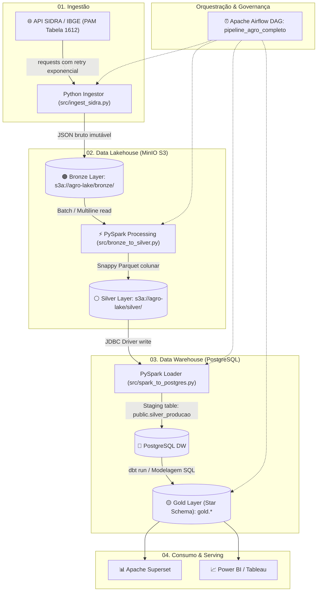
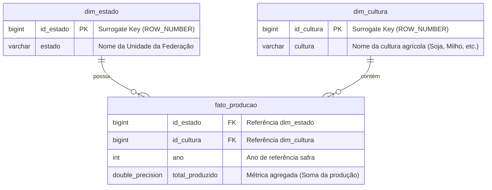
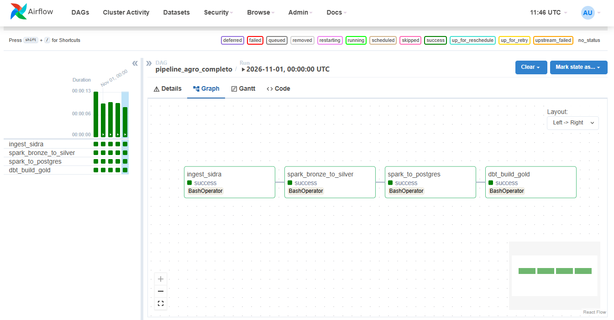
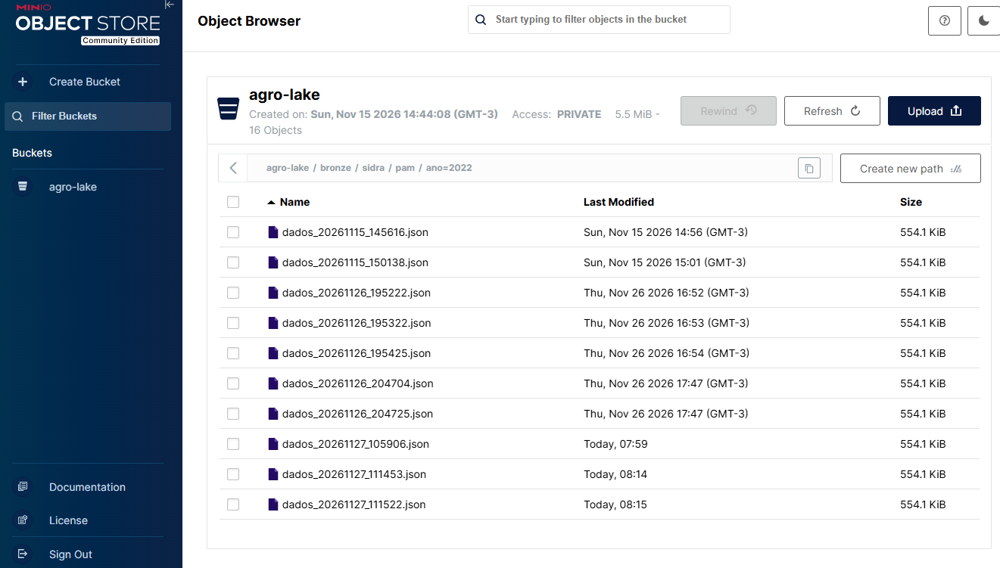
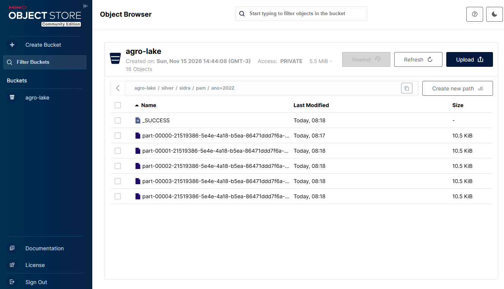
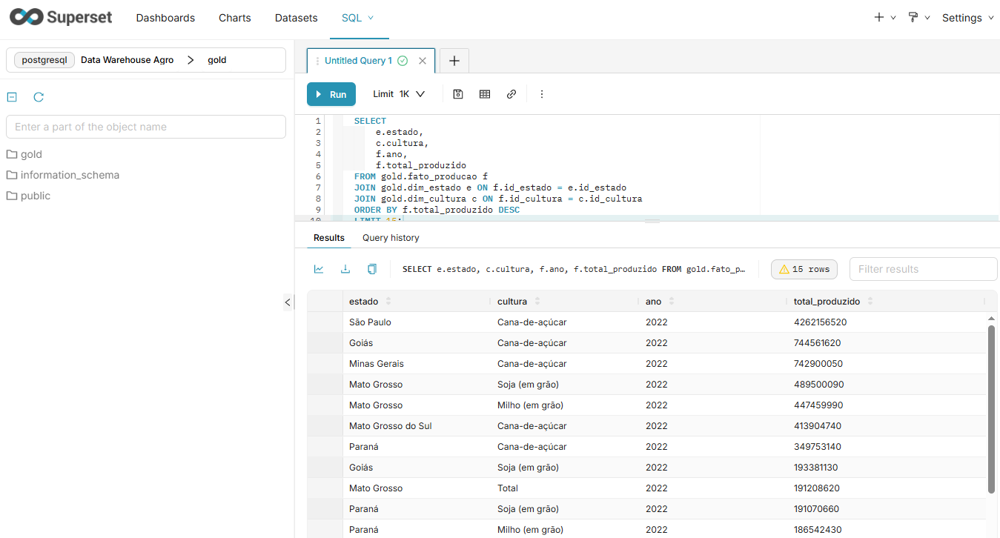

# 🌱 Agro Data Intelligence Brasil

[](https://airflow.apache.org/)
[](https://spark.apache.org/)
[](https://www.getdbt.com/)
[](https://min.io/)
[](https://www.postgresql.org/)
[](https://superset.apache.org/)
[](https://www.docker.com/)

> **Plataforma de Engenharia de Dados End-to-End** para ingestão, processamento distribuído, modelagem dimensional e visualização analítica da produção agrícola brasileira, fundamentada nos pilares da arquitetura **Medallion (Lakehouse)**.

---

## 📑 Sumário

- [Visão Geral & Contexto de Negócio](#-visão-geral--contexto-de-negócio)
- [Arquitetura da Solução](#-arquitetura-da-solução)
- [Arquitetura Medallion (Data Lakehouse)](#-arquitetura-medallion-data-lakehouse)
- [Modelagem Dimensional (Star Schema)](#-modelagem-dimensional-star-schema)
- [Stack de Tecnologias](#-stack-de-tecnologias)
- [Estrutura do Repositório](#-estrutura-do-repositório)
- [Decisões Arquiteturais (ADRs)](#-decisões-arquiteturais-adrs)
- [Como Executar Localmente](#-como-executar-localmente)
- [Monitoramento & Portas de Acesso](#-monitoramento--portas-de-acesso)
- [Evidências em Produção (Screenshots)](#-evidências-em-produção-screenshots)
- [Próximos Passos (Roadmap)](#-próximos-passos-roadmap)

---

## 🎯 Visão Geral & Contexto de Negócio

Os dados estatísticos e climáticos do agronegócio nacional (IBGE, CONAB, INMET) encontram-se fragmentados e distribuídos em múltiplos formatos governamentais com baixa padronização.

Esta plataforma resolve esse desafio integrando a **Pesquisa Agrícola Municipal (PAM / SIDRA)** através de uma esteira automatizada capaz de responder:
- *Qual a evolução e o ranking dos estados de maior produtividade por cultura agrícola?*
- *Como se comportam os volumes produzidos frente aos limites de área colhida ao longo das safras?*
- *Como disponibilizar dados limpos, tipados e governados para cientistas de dados, analistas de BI e stakeholders?*

---

## 🏗️ Arquitetura da Solução

O fluxo implementa orquestração resiliente com **Apache Airflow**, armazenamento em **Object Storage MinIO (S3)**, processamento escalável via **PySpark** e transformações analíticas governadas por **dbt**:



---

## 🏅 Arquitetura Medallion (Data Lakehouse)

| Camada | Armazenamento / Tabela | Formato | Papel na Plataforma |
| :--- | :--- | :--- | :--- |
| **🟤 Bronze** | `agro-lake/bronze/sidra/pam/ano=YYYY/` | **JSON** | Dados brutos originais mantidos de forma imutável, particionados por ano/data com metadados de carga. |
| **⚪ Silver** | `agro-lake/silver/sidra/pam/ano=YYYY/` | **Parquet (Snappy)** | Limpeza de metadados IBGE, sanitização de caracteres (`..`, `-`), inferência estrita de tipos (`Double`, `Integer`) e compactação colunar de alto desempenho. |
| **🟡 Gold** | PostgreSQL Schemas (`public.dim_*`, `public.fato_*`) | **Relacional (dbt View/Table)** | Modelagem dimensional **Star Schema** orientada ao negócio, com métricas agregadas e Surrogate Keys para consultas analíticas ultra-rápidas. |

---

## ⭐ Modelagem Dimensional (Star Schema)

A camada **Gold** é materializada no PostgreSQL através de modelos **dbt**, estabelecendo integridade relacional e linhagem rastreável:



---

## 🛠️ Stack de Tecnologias

| Domínio | Tecnologia | Função no Projeto |
| :--- | :--- | :--- |
| **Linguagens** | Python 3.11, SQL | Scripts de ingestão, pipeline Spark e modelos dbt |
| **Orquestração** | Apache Airflow 2.8.1 | DAG com retries automáticos, controle de dependências e agendamento |
| **Object Storage** | MinIO (Chainguard) | Simulação do AWS S3 em ambiente local compatível com API S3/S3A |
| **Big Data / Engine** | Apache Spark 3.5+ (PySpark) | Processamento distribuído, conversão JSON-Parquet e escrita JDBC |
| **Transformação / DW** | dbt (Data Build Tool) | Modelagem dimensional modular, controle de linhagem (lineage) e testes |
| **Serving Layer** | PostgreSQL 16 Alpine | Armazenamento de metadados operacionais e tabelas fato/dimensão |
| **Visualização / BI** | Apache Superset | Dashboards interativos e exploração self-service de métricas agrícolas |
| **Contêineres & Redes** | Docker & Docker Compose | Ambientes isolados com limites de recursos (`mem_limit`) e `healthchecks` |

---

## 📂 Estrutura do Repositório

```bash
agro-data-intelligence/
├── dags/
│   └── dag_agro_pipeline.py          # DAG do Airflow orquestrando todo o ciclo
├── dbt_agro/                         # Projeto dbt Core
│   ├── dbt_project.yml               # Configurações do projeto e materializações
│   ├── profiles.yml                  # Perfil de conexão PostgreSQL via dbt
│   └── models/
│       ├── dim_cultura.sql           # Dimensão Cultura com Surrogate Key
│       ├── dim_estado.sql            # Dimensão Estado com Surrogate Key
│       └── fato_producao.sql         # Fato analítica agregada com referências dbt
├── docker/
│   └── postgres/
│       └── init.sql                  # Script inicial criando bancos 'airflow' e 'superset'
├── src/
│   ├── ingest_sidra.py               # Ingestor Python com retry exponencial e upload no MinIO
│   ├── bronze_to_silver.py           # Pipeline PySpark: leitura do S3A, tratamento e Parquet
│   └── spark_to_postgres.py          # Pipeline PySpark: carga JDBC direta no Data Warehouse
├── .env.example                      # Template de variáveis de ambiente seguras
├── Dockerfile.airflow                # Imagem personalizada com JRE (Java), PySpark e dbt
├── docker-compose.yml                # Orquestração completa de 4 containers integrados
└── README.md                         # Documentação técnica do projeto
```

---

## 💡 Decisões Arquiteturais (ADRs)

* **Por que MinIO em vez de salvar diretamente no PostgreSQL?**
  Garante o desacoplamento entre armazenamento e processamento. O dado bruto (Bronze) é preservado integralmente na sua forma original, permitindo reprocessamentos históricos (re-play) sem custos de requisição externa.
* **Por que PySpark para a camada Silver?**
  Prepara a plataforma para grandes escalas de dados (como medições horárias do INMET). A utilização de Parquet + Snappy reduz em até **80%** o espaço de armazenamento e acelera as leituras analíticas em comparação com CSV ou JSON.
* **Por que dbt para a camada Gold?**
  Permite que as regras de negócio e modelagem dimensional sejam mantidas em SQL com documentação, testes de integridade e linhagem automática de dados (lineage), separando a carga pesada de dados da modelagem de negócio.
* **Por que não Apache Kafka neste momento?**
  Os dados estatísticos agrícolas governamentais são consolidados em periodicidades anuais e mensais. A introdução de streaming em tempo real introduziria complexidade desnecessária e custo cognitivo sem ganho real para o usuário final.

---

## 🚀 Como Executar Localmente

### Pré-requisitos
- [Docker](https://docs.docker.com/get-docker/) e [Docker Compose](https://docs.docker.com/compose/) instalados.
- Mínimo de 8 GB de RAM recomendados.

### Passo a Passo

1. **Clone o repositório:**
   ```bash
   git clone https://github.com/CostaPaiiva/Portfolio-showcase.git
   cd Portfolio-showcase/agro-data-intelligence
   ```

2. **Configure o arquivo de ambiente:**
   ```bash
   cp .env.example .env
   # Se necessário, ajuste os valores dentro do arquivo .env
   ```

3. **Inicie os serviços via Docker Compose:**
   ```bash
   docker compose up -d --build
   ```
   > Esse comando irá construir a imagem customizada do Airflow (com Java e PySpark) e inicializar Postgres, MinIO, Airflow e Superset.

4. **Execute o Pipeline:**
   - Acesse o Airflow em `http://localhost:18080` (Usuário: `admin` | Senha: `admin`).
   - Localize a DAG **`pipeline_agro_completo`** e ative o botão **Unpause**.
   - Dispare manualmente a DAG clicando em **Trigger DAG**.

---

## 🖥️ Monitoramento & Portas de Acesso

| Serviço | URL de Acesso | Credenciais Padrão | Finalidade |
| :--- | :--- | :--- | :--- |
| **Apache Airflow** | `http://localhost:18080` | `admin` / `admin` | Orquestração e monitoramento de tasks |
| **MinIO Console** | `http://localhost:9001` | Definido no `.env` | Inspeção visual dos buckets e arquivos S3 |
| **MinIO S3 API** | `http://localhost:9000` | Definido no `.env` | Endpoint da API S3 para conexão de scripts |
| **PostgreSQL DW** | `localhost:15432` | Definido no `.env` | Banco relacional contendo as tabelas Gold |
| **Apache Superset** | `http://localhost:8088` | `admin` / `admin` | Criação e visualização de dashboards BI |

---

## 📸 Evidências em Produção (Screenshots)

### 1. Orquestração End-to-End (Apache Airflow)
Execução completa da DAG `pipeline_agro_completo`, orquestrando ingestão da API SIDRA, transformação distribuída em PySpark, carga JDBC no PostgreSQL e modelagem dimensional com dbt.



### 2. Data Lake — Camada Bronze (MinIO S3)
Armazenamento imutável dos dados brutos da pesquisa PAM/IBGE em formato **JSON**, particionados por fonte e ano de referência.



### 3. Data Lake — Camada Silver (MinIO S3 / PySpark)
Dados tratados, tipados e convertidos pelo **Apache Spark** para formato colunar **Parquet (Snappy)** com marcador `_SUCCESS`.



### 4. Camada Gold & Consumo Analítico (Apache Superset + dbt)
Consulta SQL executada no **Superset SQL Lab** diretamente sobre o Star Schema (`gold.fato_producao`, `gold.dim_estado`, `gold.dim_cultura`), exibindo os maiores produtores agrícolas do Brasil.



---

## 🗺️ Próximos Passos (Roadmap)

- [ ] Ingestão de séries meteorológicas diárias da API do INMET.
- [ ] Implementação de testes automatizados com `dbt test` (verificação de unicidade e valores nulos).
- [ ] Criação de painel executivo padrão no Apache Superset com mapas de calor por estado.
- [ ] Criação de CI/CD via GitHub Actions com `sqlfluff` e `pytest`.

---

Desenvolvido por **[Costa Paiva](https://github.com/CostaPaiiva)**. Sinta-se à vontade para contribuir ou entrar em contato!
